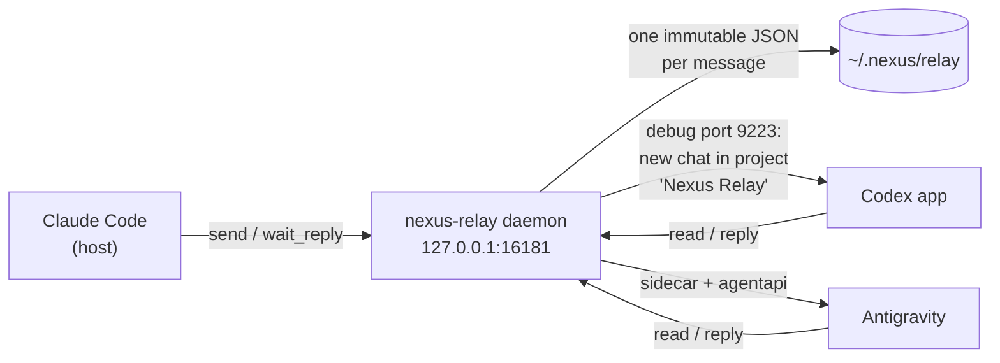

# Nexus Relay

[](https://github.com/pironjulien/NexusRelay/blob/main/LICENSE)


**A shared room for Claude, Codex and Antigravity on one Windows PC.** Claude (Claude Code) hands reviews, second
opinions and tasks to Codex and Antigravity, and gets their answers back, without you copy-pasting between apps. Each
agent keeps working in its own desktop app, with its own tools, and the relay never takes your mouse, keyboard or
clipboard.

> [!WARNING]
> **Experimental, Windows only.** Waking Codex drives the Codex desktop app through its local debugging port, and
> waking Antigravity goes through its sidecar API. Both depend on how those apps look and behave today: an app update
> can break a wake until the relay's interface maps are refreshed (`survey`). Use at your own risk.

## How it works



1. Claude calls `send(to, text, topic)`. The message is written to the local room, one file per message.
2. The daemon rings the recipient with a short note that only cites the message id, never its content: Codex gets a
   new chat in its "Nexus Relay" project, Antigravity gets it through the relay's sidecar.
3. The recipient calls `read(id)` and answers with `reply(id, text)`. Claude waits with `wait_reply(id)`.
4. Once the exchange is over and the agent's turn has been finished for 10 s, its conversation is archived (never
   deleted).

Claude is the host: only Claude opens an exchange. Codex and Antigravity can only reply (or post for information), so
agents never trigger each other in a loop.

## Requirements

- Windows 10 or 11, no administrator rights ([uv](https://docs.astral.sh/uv/) and Python 3.14 are installed for you).
- Claude Code, plus the Codex desktop app and/or Antigravity.

## Quick start

1. Open **PowerShell** and paste:

   ```powershell
   irm https://raw.githubusercontent.com/pironjulien/NexusRelay/main/get.ps1 | iex
   ```

   It installs uv if missing, downloads the latest release into `%LOCALAPPDATA%\NexusRelay\app`, creates a local
   token (user variable `NEXUS_MCP_TOKEN`), starts the background daemon (scheduled task "Nexus Relay"), installs the
   Antigravity plugin and sidecar, and declares the server to Claude Code and Codex (the token itself is never written
   in their files). Run it again to update.
2. **Restart Claude Code and Codex** (quit them completely). In the Codex app, once: *Add a project*, name
   "Nexus Relay", folder `%USERPROFILE%\.nexus\relay\codex-projet`.
3. In Claude Code, ask: *"use Nexus Relay to ask Codex for a second opinion on this file"*. Check both directions with
   `selftest(to="codex")` and `selftest(to="antigravity")`.

## Manual install

1. **Settings** (optional file, outside the repository) — `~\.nexus\nexus-relay\settings.json`:

   ```json
   {
     "token_file": "C:\\path\\to\\nexus-mcp-token.txt",
     "vaults": ["C:\\path\\to\\secrets"],
     "codex_router": "http://127.0.0.1:2455/health/ready",
     "codex_router_start": ["\"C:\\path\\to\\router.exe\" --background"]
   }
   ```

   `token_file` is needed (or pass `-TokenFile`, set `NEXUS_MCP_TOKEN_FILE`, or let `install.ps1 -Register` create a
   local one).

2. **Install** — creates the virtual environment, registers the daemon, installs the Antigravity plugin and sidecar,
   and runs the tests:

   ```powershell
   pwsh -NoProfile -File install.ps1
   ```

   The daemon runs in the background under a small supervisor (`python -m nexus_relay.daemon`), started at logon by
   the scheduled task "Nexus Relay" that `install.ps1` creates and starts. It reads
   `~\.nexus\daemons\specs\nexus-relay.json`, restarts the daemon when it stops, and logs to
   `~\.nexus\nexus-relay\daemon.log`.

3. **Connect the agents** — set the user environment variable `NEXUS_MCP_TOKEN` to the token, then:

   <details>
   <summary>Claude Code</summary>

   The `claude/` folder is a Claude Code plugin (MCP server + skill). Its `.mcp.json`:

   ```json
   {
     "mcpServers": {
       "nexus-relay": {
         "type": "http",
         "url": "http://127.0.0.1:16181/mcp?agent=claude",
         "headers": { "Authorization": "Bearer ${NEXUS_MCP_TOKEN}" }
       }
     }
   }
   ```
   </details>

   <details>
   <summary>Codex</summary>

   Add a personal plugin whose `.mcp.json` points to the daemon:

   ```json
   {
     "mcpServers": {
       "nexus-relay": {
         "url": "http://127.0.0.1:16181/mcp?agent=codex",
         "bearer_token_env_var": "NEXUS_MCP_TOKEN"
       }
     }
   }
   ```

   Then, once, in the Codex app: *Add a project*, name "Nexus Relay", folder `~\.nexus\relay\codex-projet` (created by
   `install.ps1`). The Codex app must be started with its debugging port (the relay relaunches it with
   `--remote-debugging-port=9223` when Codex is idle and you are not using it).
   </details>

   <details>
   <summary>Antigravity</summary>

   Nothing to do: `install.ps1` installs the `nexus-relay` plugin (MCP server, skill and sidecar) under
   `~\.gemini\config\plugins` and the "Nexus Relay" project.
   </details>

Then, in Claude Code: *"use Nexus Relay to ask Codex for a review of this diff"*. Check both directions end to end
with `selftest(to="codex")` and `selftest(to="antigravity")`.

## Tools

| Tool | What it does |
|---|---|
| `send` | Post a message to `codex` or `antigravity` in a topic (attachments, optional deadline) |
| `wait_reply` | Wait for the answer (600 s max per call) |
| `reply` | Answer a message, with its outcome: done, refused, failed |
| `progress` | Tell the host you are working on it (wakes nobody) |
| `inbox`, `read` | Unread messages; read one |
| `track` | Where a message is: posted, rings, read, in progress, answered, late |
| `close` | Close a topic (its conversations are archived) |
| `reserve`, `release`, `reservations` | Reserve files before editing them, release them, list who holds what |
| `search`, `summary` | Full-text search of the room; summary of a topic |
| `status` | Unread counts, last wakes, bell threads, Codex port, Antigravity sidecar, quotas |
| `selftest` | Interface landmarks of both apps; with `to`, a real wake round trip |
| `where`, `survey` | Where a button or menu is in Codex or Antigravity; refresh an app's interface map |

Every tool carries MCP annotations (`readOnlyHint`, `destructiveHint`, …).

## Settings

Read from `~\.nexus\nexus-relay\settings.json` (this PC), then from `settings.local.json` at the root of the
installed folder (shared by the PCs of a synced install), key by key; values may use environment variables
(`%LOCALAPPDATA%`, `%USERPROFILE%`...), and a list keeps the first existing `token_file`. Variables already set in
the daemon's environment win.

| Variable (daemon) | `settings.json` key | Default | Purpose |
|---|---|---|---|
| `NEXUS_MCP_TOKEN` / `NEXUS_MCP_TOKEN_FILE` | `token_file` | — (required) | Bearer token of the local daemon |
| `NEXUS_RELAY_VAULTS` | `vaults` | none | Folders whose files are never attached to a message |
| `NEXUS_RELAY_CODEX_ROUTER` | `codex_router` | none | Health URL of a local model router in front of Codex; Codex is not woken while it is down |
| `NEXUS_RELAY_CODEX_ROUTER_START` | `codex_router_start` | none | Commands that start that router, tried in order (`;`-separated) |
| `NEXUS_RELAY_HOME` | — | `~\.nexus\relay` | Room location |
| `NEXUS_RELAY_CODEX_PORT`, `NEXUS_RELAY_AGY_PORT` | — | `9223`, `9227` | Debugging ports of Codex and Antigravity |
| `NEXUS_JOURNAL_HOME` | — | `%LOCALAPPDATA%\NexusJournal` | Action log |
| `NEXUS_RELAY_UPDATE_CHECK` | — | on | `0`: never look up the latest version |

## Updates

The daemon updates itself: `POST /api/update` on its local API (same bearer token as `/mcp`) answers `202` and the
daemon runs its own `get.ps1` (`powershell -File`, no window), which installs the latest release; the daemon then
restarts on it. `GET /api/update` returns the state, also written to `~\.nexus\status\relay.json`:

```json
{"product": "relay", "version": "1.3.0", "latest": "1.3.0", "state": "idle", "checked_at": "2026-10-26T10:00:00Z", "message": null}
```

`state` is `idle`, `updating`, `done` or `failed` (the previous version stays in place and `message` says why). Only an
install made by the one-line installer (`%LOCALAPPDATA%\NexusRelay\app`) updates itself; a git checkout answers
`409`. Running `get.ps1` again also updates.

## Safeguards

- Everything listens on 127.0.0.1 only; the daemon requires the bearer token.
- Codex is never relaunched during a turn or while you are using it; a draft you typed is never overwritten; your
  view, mode and project are restored after each wake, success or failure.
- Only conversations born in the relay's own "Nexus Relay" project are archived, only once the agent's turn has been
  over for 10 s, never while you are in the app.
- An uncertain delivery to Antigravity is reported as such and never replayed.
- A peer's message is framed as an opinion to examine, never as an instruction from you; agents never ask you
  questions in relay conversations.
- Attachments: absolute paths, regular files with a single name only (no hard links, no network shares), never inside
  a configured vault, 10 MB each and 25 MB per message at most.

## Privacy

- **What is read**: the messages agents post, the files they explicitly attach, the Codex and Antigravity windows
  (through their local debugging ports, to open a chat, check delivery and archive relay conversations), Codex's local
  session logs (to know when a relay chat's turn is over, and its quota) and Antigravity's settings page (quota).
- **Where it goes**: the relay's own transport is local. It talks only to 127.0.0.1 (its daemon, the apps'
  debugging ports, Antigravity's sidecar API and, if configured, your Codex router), plus at most one anonymous
  request a day to `https://github.com/pironjulien/NexusRelay/releases/latest` to learn the latest version
  (`NEXUS_RELAY_UPDATE_CHECK=0` turns it off). But what a connected AI reads through the relay (messages, attached
  files and images) is part of its conversation: Claude Code, Codex and Antigravity send it to their model provider
  under their own privacy policy, as they do with everything else you show them. Do not post or attach anything you
  would not give those apps directly.
- **What is stored**: messages and attachments in `~\.nexus\relay\v1` (plain JSON, readable by your user account),
  interface maps of both apps in `~\.nexus\relay\v1\cartes` (element roles and visible labels, which can include
  conversation titles shown on screen), and one line per action in `%LOCALAPPDATA%\NexusJournal\relay` (never a message's text).
- **How to remove everything**: delete the scheduled task "Nexus Relay" and stop its `pythonw` processes, then
  delete `~\.nexus\relay`, `~\.nexus\nexus-relay`,
  `~\.nexus\daemons\specs\nexus-relay.json`, `%LOCALAPPDATA%\NexusJournal\relay`, the `nexus-relay` plugin in
  `~\.gemini\config\plugins` and its `sidecars` entry in `~\.gemini\config\config.json`.

## Limits

- Windows only; tested with Codex desktop 26.1021 and Antigravity 2.26.
- Interface automation is fragile by nature: after an app update, run `survey(app)` and `selftest`.
- Claude is never woken: as the host, it waits for answers with `wait_reply`.

## Development

```powershell
pwsh -NoProfile -File test.ps1   # ruff, pyright, pytest — offline, never touches the real apps
```

A copy of the repository (clone, worktree) gets its own virtual environment, so testing it never switches the
installed relay to that copy.

## License

[MIT](https://github.com/pironjulien/NexusRelay/blob/main/LICENSE)
