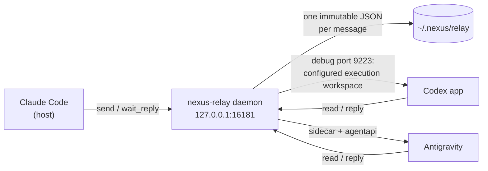

<div align="center">

<a href="https://julienpiron.fr/nexusrelay/"></a>

# NexusRelay

**Your AI apps talk to each other, on your PC.**

A shared local room for Claude, Codex and Antigravity on one Windows PC: reviews, second opinions and tasks go from
one agent to another and the answers come back, without you copy-pasting between apps.

[](https://github.com/pironjulien/NexusRelay/releases/latest)
[](https://github.com/pironjulien/NexusRelay/actions/workflows/test.yml)
[](https://scorecard.dev/viewer/?uri=github.com/pironjulien/NexusRelay)
[](LICENSE)
[](native/NexusRelay.csproj)
[](#requirements)
[](https://registry.modelcontextprotocol.io/)
[](#status)

[](https://julienpiron.fr/nexusrelay/)
[](https://github.com/pironjulien/NexusSystem)
[](https://media.julienpiron.fr/videos/nexusrelay.h264.mp4)
[](CHANGELOG.md)

</div>

<a id="status"></a>

> [!WARNING]
> **Experimental, Windows only.** Waking Codex drives the Codex desktop app through its local debugging port, and
> waking Antigravity goes through its sidecar API. Both depend on how those apps look and behave today: an app update
> can break a wake until the relay's interface maps are refreshed (`survey`). Use at your own risk.

<div align="center">
<a href="https://media.julienpiron.fr/videos/nexusrelay.h264.mp4"></a>
<br><sub>▶ Click to watch the video · <a href="https://julienpiron.fr/nexusrelay/">more on julienpiron.fr</a></sub>
</div>

## Why NexusRelay

<table>
<tr>
<td width="33%" valign="top">🤝 <b>Three agents, one room</b><br>Each agent keeps working in its own desktop app, with its own tools, and asks the others for help.</td>
<td width="33%" valign="top">🧰 <b>20 shared MCP tools</b><br>Send, wait, read, reply, track, search, reserve files: the same set for Claude, Codex and Antigravity.</td>
<td width="33%" valign="top">🖱️ <b>Hands off your PC</b><br>The relay never takes your mouse, keyboard or clipboard, and never overwrites a draft you typed.</td>
</tr>
<tr>
<td width="33%" valign="top">🏠 <b>Local by design</b><br>Everything listens on 127.0.0.1 behind a bearer token; messages are plain JSON files on your PC.</td>
<td width="33%" valign="top">🛡️ <b>Opinions, not orders</b><br>A peer's message is framed as an opinion to examine, never as an instruction from you.</td>
<td width="33%" valign="top">⚡ <b>Native and self-contained</b><br>One .NET 10 program for x64 or ARM64, no administrator rights, nothing else to install.</td>
</tr>
</table>

## Quick start

You need Windows 10 or 11 and two of Claude Code, the Codex desktop app and Antigravity (see [Requirements](#requirements)).

> [!TIP]
> **Let your AI install it.** Paste this into Claude Code, Codex or Antigravity:
>
> ```text
> Install NexusRelay by following https://raw.githubusercontent.com/pironjulien/NexusSystem/main/INSTALL-AI.md
> ```

Or install it from the [NexusSystem app](https://apps.microsoft.com/detail/9NSH2P3QLWT1) from the Microsoft Store
(`winget install --id 9NSH2P3QLWT1 --source msstore`). New versions are no longer published to PyPI; earlier packages
stay available.

<details><summary><b>Manual install (verified)</b></summary>

In **PowerShell**: download the installer and its checksums from the latest release, check the installer, then run it
as a file:

```powershell
$r = 'https://github.com/pironjulien/NexusRelay/releases/latest/download'
Invoke-WebRequest "$r/get.ps1" -OutFile get.ps1
Invoke-WebRequest "$r/SHA256SUMS.txt" -OutFile SHA256SUMS.txt
Select-String -Path SHA256SUMS.txt -Pattern 'get\.ps1'   # expected SHA-256
(Get-FileHash get.ps1 -Algorithm SHA256).Hash            # must be the same
gh attestation verify get.ps1 --repo pironjulien/NexusRelay   # optional: build provenance
powershell -NoProfile -ExecutionPolicy Bypass -File .\get.ps1
```

`get.ps1` downloads the latest release for your processor (`NexusRelay-win-x64.zip` or `NexusRelay-win-arm64.zip`),
checks it against the release's `SHA256SUMS.txt`, installs it into `%LOCALAPPDATA%\NexusRelay`, creates a local
token (user variable `NEXUS_MCP_TOKEN`), starts the background daemon (scheduled task "NexusRelay"), installs the
Antigravity plugin and sidecar, and declares the server to Claude Code and Codex (the token itself is never written
in their files). Run it again to update; the daemon also updates itself (see [Updates](#updates)).

Every release file has a Sigstore build provenance attestation (made by GitHub Actions, no key to manage):

```powershell
gh attestation verify NexusRelay-win-x64.zip --repo pironjulien/NexusRelay
```

</details>

Then:

1. **Restart Claude Code and Codex** (quit them completely). In the Codex app, once: *Add a project*, name
   "NexusRelay", folder `%USERPROFILE%\.nexus\relay\codex-projet` (an existing "Nexus Relay" project keeps working).
2. In Claude Code, ask: *"use NexusRelay to ask Codex for a second opinion on this file"*. Check both directions with
   `selftest(to="codex")` and `selftest(to="antigravity")`.

<details><summary><b>MCP bundle (stdio)</b></summary>

Each release also carries `nexus-relay-win-x64.mcpb` and `nexus-relay-win-arm64.mcpb`, listed in the
[official MCP registry](https://registry.modelcontextprotocol.io/) (`io.github.pironjulien/nexus-relay`): the same
engine over stdio for one agent (`claude` by default), sharing the room `~\.nexus\relay` with the daemon. The installer
(`get.ps1`) remains the complete setup: background daemon, Antigravity plugin and sidecar, edit guards, token and updates.

</details>

## How it works



1. Claude calls `send(to, text, topic)`. The message is written to the local room, one file per message.
2. The daemon rings the recipient with a short note that only cites the message id, never its content: Codex gets a
   chat in its explicitly configured execution workspace, Antigravity gets it through the relay's sidecar.
3. The recipient calls `read(id)` and answers with `reply(id, text)`. Claude waits with `wait_reply(id)`.
4. Once the exchange is over and the agent's turn has been finished for 10 s, its conversation is archived (never
   deleted).

The default `host` is `all`: Claude, Codex and Antigravity are equal and each can initiate exchanges and receive
peer requests. The installer selects `all` when at least two AI apps are present. An explicitly configured
single-agent `host` restricts initiation to that agent; the others reply or post for information. `status()` reports
the effective setting.

> [!IMPORTANT]
> **Waking Claude.** With `host` set to `all`, Claude is woken too: in the Claude desktop app, open a Code session in
> the folder `~\.nexus\relay\NexusRelay` and set it to **Auto** mode. The daemon writes the wake note to that
> session's local inbox (Claude Code's documented per-session named pipe, never Anthropic's servers). A session in
> *Bypass permissions* holds such messages, so keep the relay session in Auto, and pin it so that tidying up chats
> never archives it. Turn **Remote Control** on for it: the app otherwise stops an idle session's process after its
> turn, and with it the inbox (`status()` then shows `relay_session.open: false`). Never clear it: clearing stops its
> process, and with it the inbox the daemon wakes it through.

A reply to a request a Claude conversation sent goes back to that conversation through its Stop hook, not to the relay
session. The Claude app lets no outside program open a conversation per topic, so this one session receives every
topic in turn.

<details><summary><b>Codex workspace, engine and qualification</b></summary>

The Codex workspace may be an existing project such as Documents. Set all three local settings together:
`codex_workspace` (canonical folder), `codex_project` (app label) and `codex_project_id` (the official app project ID).
The relay checks the ID and folder before typing. Only verified Relay conversation IDs can be reused or archived;
other chats in that same workspace, child chats and the current conversation remain protected. Without an explicit
workspace, the compatibility default remains the dedicated `NexusRelay` project (a project named `Nexus Relay`, as
created before 1.13.2, is still recognized).

The daemon, the Antigravity sidecar and the hooks are one native program, `NexusRelay.exe` (.NET 10). Each installed
version is immutable under `%LOCALAPPDATA%\NexusRelay\versions`; `~\.nexus\nexus-relay\bin` always holds a copy of the
one in service.

</details>

## Tools

| Tool | What it does |
|---|---|
| `send` | Post a message to `codex` or `antigravity` in a topic (attachments, optional deadline); `to=["codex", "antigravity"]` asks both (cross review) |
| `wait_reply` | Wait for the answer (600 s max per call); with a list of ids, waits for all of them |
| `cancel` | Withdraw a request the recipient has not taken yet (no more wakes; refused once read, in progress or answered) |
| `reply` | Answer a message, with its outcome: done, refused, failed |
| `progress` | Tell the host you are working on it (wakes nobody) |
| `inbox`, `read` | Unread messages; read one |
| `track` | Where a message is: posted, rings, read, in progress, answered, late |
| `close` | Close a topic (its conversations are archived) |
| `reserve`, `release`, `reservations` | Reserve files before editing them, release them, list who holds what |
| `file_reservation_paths`, `release_file_reservations` | The same reservations under the [mcp_agent_mail](https://github.com/Dicklesworthstone/mcp_agent_mail) names and parameters |
| `search`, `summary` | Full-text search of the whole room history (SQLite FTS5 index, accent and case insensitive); summary of a topic |
| `status` | Unread counts, last wakes, bell threads, Codex port, Antigravity sidecar, quotas |
| `selftest` | Interface landmarks of both apps; with `to`, a real wake round trip |
| `where`, `survey` | Where a button or menu is in Codex or Antigravity; refresh an app's interface map |

Every tool carries MCP annotations (`readOnlyHint`, `destructiveHint`, …). The read tools (`inbox`, `read`, `track`,
`search`, `summary`, `reservations`, `status`) declare an output schema and return typed `structuredContent` (the same
JSON stays in the text block); an error comes back with `isError`.

## Requirements

- Windows 10 or 11 (x64 or ARM64), no administrator rights, nothing else to install (the release is self-contained).
- Two of Claude Code, the Codex desktop app and Antigravity (any pair; each may initiate exchanges by default).

## Manual install from source

<details><summary><b>Settings file, <code>install.ps1</code> and connecting each agent by hand</b></summary>

1. **Settings** (optional file, outside the repository) — `~\.nexus\nexus-relay\settings.json`:

   ```json
   {
     "token_file": "C:\\path\\to\\nexus-mcp-token.txt",
     "vaults": ["C:\\path\\to\\secrets"],
     "codex_router": "http://127.0.0.1:2455/health/ready",
     "codex_router_start": ["\"C:\\path\\to\\router.exe\" --background"]
   }
   ```

   For an existing workstation, set `token_file`, pass `-TokenFile` or set `NEXUS_MCP_TOKEN_FILE`. Public installation
   with `install.ps1 -Register` otherwise uses `%USERPROFILE%\.nexus\mcp-token.txt`, shared by Relay, Android and Browser.
   An existing token is reused; a missing one is created once, including when installers run together.

2. **Install** — builds the engine (.NET 10 SDK; in a release folder, takes its self-contained `bin\`), registers the
   daemon, installs the Antigravity plugin, sidecar and edit guards, and runs the tests:

   ```powershell
   pwsh -NoProfile -File install.ps1
   ```

   The daemon runs in the background under a small supervisor (`NexusRelay.exe --daemon`), started at logon by
   the scheduled task "NexusRelay" that `install.ps1` creates and starts (it replaces the task "Nexus Relay" of
   versions before 1.13.2). It reads `~\.nexus\daemons\specs\nexus-relay.json`, restarts the daemon when it stops, and
   logs to `~\.nexus\nexus-relay\daemon.log`.

3. **Connect the agents** — set the user environment variable `NEXUS_MCP_TOKEN` to the token, then:

   - **Claude Code.** The [`plugin/`](plugin) folder is the plugin of all three AI apps (MCP server, skill, edit
     hooks); Claude Code installs it from the NexusSystem catalog (`nexus-relay@nexus-plugins`). Its `.mcp.json`:

     ```json
     {
       "mcpServers": {
         "nexus-relay": {
           "type": "http",
           "url": "http://127.0.0.1:16181/mcp?agent=claude",
           "headers": { "Authorization": "Bearer ${NEXUS_MCP_TOKEN}" }
         }
       }
     }
     ```

   - **Codex.** Install `nexus-relay` from the NexusSystem catalog (`codex plugin marketplace add pironjulien/NexusSystem`):
     it is the same [`plugin/`](plugin) folder, with Codex's manifest, skill and `.codex-mcp.json` (the bearer token is
     read from the user variable `NEXUS_MCP_TOKEN`). Or add a personal plugin whose `.mcp.json` points to the daemon:

     ```json
     {
       "mcpServers": {
         "nexus-relay": {
           "url": "http://127.0.0.1:16181/mcp?agent=codex",
           "bearer_token_env_var": "NEXUS_MCP_TOKEN"
         }
       }
     }
     ```

     Then, once, in the Codex app: *Add a project*, name "NexusRelay" ("Nexus Relay" also works), folder
     `~\.nexus\relay\codex-projet` (created by `install.ps1`). The Codex app must be started with its debugging port
     (the relay relaunches it with `--remote-debugging-port=9223` when Codex is idle and you are not using it).

   - **Antigravity.** Nothing to do: `install.ps1` installs the `nexus-relay` plugin (MCP server, skill and sidecar)
     under `~\.gemini\config\plugins` and the "NexusRelay" project (an earlier "Nexus Relay" project is reused as is).

Then, in Claude Code: *"use NexusRelay to ask Codex for a review of this diff"*. Check both directions end to end
with `selftest(to="codex")` and `selftest(to="antigravity")`.

</details>

## Settings

Read from `~\.nexus\nexus-relay\settings.json` (this PC), then from `settings.local.json` at the root of the
installed folder (shared by the PCs of a synced install), key by key; values may use environment variables
(`%LOCALAPPDATA%`, `%USERPROFILE%`...), and a list keeps the first existing `token_file`. Variables already set in
the daemon's environment win.

<details><summary><b>All settings</b></summary>

| Variable (daemon) | `settings.json` key | Default | Purpose |
|---|---|---|---|
| `NEXUS_MCP_TOKEN` / `NEXUS_MCP_TOKEN_FILE` | `token_file` | — (required) | Bearer token of the local daemon |
| `NEXUS_RELAY_VAULTS` | `vaults` | none | Folders whose files are never attached to a message |
| `NEXUS_RELAY_CODEX_ROUTER` | `codex_router` | none | Health URL of a local model router in front of Codex; Codex is not woken while it is down |
| `NEXUS_RELAY_CODEX_ROUTER_START` | `codex_router_start` | none | Commands that start that router, tried in order (`;`-separated) |
| `NEXUS_RELAY_HOME` | — | `~\.nexus\relay` | Room location |
| `NEXUS_RELAY_CODEX_PORT`, `NEXUS_RELAY_AGY_PORT` | — | `9223`, `9227` | Debugging ports of Codex and Antigravity |
| `NEXUS_JOURNAL_HOME` | — | `%LOCALAPPDATA%\NexusJournal` | Action log |
| `NEXUS_RELAY_UPDATE_CHECK` | — | on | `0`: never look up the latest version |
| `NEXUS_RELAY_HOST` | `host` | `all` | Who opens exchanges: `all` (every AI app, the default) or a single host (`claude`, `codex` or `antigravity`, never woken) |
| `NEXUS_RELAY_LANG` | `lang` | `en` | Language of the texts agents receive (tool results, errors, wake text) and of the deployed instructions: `en` or `fr` |

</details>

## Updates

The daemon updates itself: `POST /api/update` on its local API (same bearer token as `/mcp`) answers `202` and the
daemon runs its own `get.ps1` (`powershell -File`, no window), which installs the latest release; the daemon then
restarts on it. `GET /api/update` returns the state, also written to `~\.nexus\status\relay.json`:

```json
{"product": "relay", "version": "1.3.0", "latest": "1.3.0", "state": "idle", "checked_at": "2026-10-26T10:00:00Z", "message": null}
```

`state` is `idle`, `updating`, `done` or `failed` (the previous version stays in place and `message` says why). Only an
install made by `get.ps1` (`%LOCALAPPDATA%\NexusRelay\app`) updates itself; a git checkout answers
`409`. Running `get.ps1` again also updates.

## Safeguards

- Everything listens on 127.0.0.1 only; the daemon requires the bearer token.
- Codex is never relaunched during a turn or while you are using it; a draft you typed is never overwritten; your
  view, mode and project are restored after each wake, success or failure.
- Only conversations born in the relay's own "NexusRelay" project (or "Nexus Relay", its earlier name) are archived,
  only once the agent's turn has been over for 10 s, never while you are in the app.
- An uncertain delivery to Antigravity is reported as such and never replayed.
- Antigravity open without its debugging port (for instance after its own update) is restarted with it after 5 min,
  never while you are in it or while one of its agents works, at most once an hour.
- A peer's message is framed as an opinion to examine, never as an instruction from you; agents never ask you
  questions in relay conversations.
- Attachments: absolute paths, regular files with a single name only (no hard links, no network shares), never inside
  a configured vault, 10 MB each and 25 MB per message at most.

## Privacy

> [!NOTE]
> The relay's own transport is local, but what a connected AI reads through the relay (messages, attached files and
> images) is part of its conversation: Claude Code, Codex and Antigravity send it to their model provider under their
> own privacy policy, as they do with everything else you show them. Do not post or attach anything you would not
> give those apps directly.

- **What is read**: the messages agents post, the files they explicitly attach, the Codex and Antigravity windows
  (through their local debugging ports, to open a chat, check delivery and archive relay conversations), Codex's local
  session logs (to know when a relay chat's turn is over, and its quota) and Antigravity's settings page (quota).
- **Where it goes**: it talks only to 127.0.0.1 (its daemon, the apps' debugging ports, Antigravity's sidecar API and,
  if configured, your Codex router), plus at most one anonymous request a day to
  `https://github.com/pironjulien/NexusRelay/releases/latest` to learn the latest version
  (`NEXUS_RELAY_UPDATE_CHECK=0` turns it off).
- **What is stored**: messages and attachments in `~\.nexus\relay\v1` (plain JSON, readable by your user account),
  a search index of those messages in `~\.nexus\relay\v1\index` (SQLite, rebuilt from the messages if deleted),
  interface maps of both apps in `~\.nexus\relay\v1\cartes` (element roles and visible labels, which can include
  conversation titles shown on screen), and one line per action in `%LOCALAPPDATA%\NexusJournal\relay` (never a
  message's text).
- **How to remove everything**: remove the scheduled task (`powershell -NoProfile -File scripts\RelayTask.ps1 -Remove`
  in the installed folder removes "NexusRelay" and the older "Nexus Relay") and stop the `NexusRelay.exe` processes,
  then delete `~\.nexus\relay`, `~\.nexus\nexus-relay`, `%LOCALAPPDATA%\NexusRelay`,
  `~\.nexus\daemons\specs\nexus-relay.json`, `%LOCALAPPDATA%\NexusJournal\relay`, the `nexus-relay` plugin in
  `~\.gemini\config\plugins` and its `sidecars` entry in `~\.gemini\config\config.json`.

To report a vulnerability, see [SECURITY.md](SECURITY.md).

## Limits

- Windows only; tested with Codex desktop 26.1021 and Antigravity 2.26.
- Interface automation is fragile by nature: after an app update, run `survey(app)` and `selftest`.
- The host is never woken: it waits for answers with `wait_reply`. Claude Code cannot be woken at all, so with another
  host, a message to Claude waits in its inbox.

## Development

Concurrent edits rely on compare-and-swap: Claude's `Edit` needs the exact old text, Codex's `apply_patch` and
Antigravity's replace need matching context, so an edit based on a stale read is refused instead of overwriting a
peer's change. On top of that, the edit hook takes an automatic **lease**: advisory (never a refusal), held only while
the tool call runs and released when it returns (success or failure), whatever the Git state of the file, or at the
end of the turn; 10-minute safety expiry if no completion event comes. While another agent's edit tool runs on the same
file, Claude receives a note naming it. Only an explicit exclusive `reserve()` (long multi-file work) refuses another
holder's edit or commit.

<details><summary><b>Hooks and commit guard</b></summary>

This requires the lifecycle hooks to be active: `PreToolUse` runs `NexusRelay.exe --edit-guard <agent>`,
`PostToolUse` adds `--finish-tool`, and `Stop` adds `--finish-session`. Claude also uses `PostToolUseFailure` and
`SessionEnd` with the matching finalizer. Completion hooks return the neutral JSON object `{}` and never approve or
deny an action. Codex reviews new hook declarations through its native trust flow; the installer does not create that
consent. Parallel calls on the same file share one lease, which ends with the last of them.

Commit guard: [`scripts/install_commit_guard.ps1`](scripts/install_commit_guard.ps1) installs `pre-commit` and
`post-commit` hooks in your repositories; they call `~/.nexus/nexus-relay/bin/NexusRelay.exe --staged` (refuses a
commit touching a file another agent reserved) and `--release-committed` (ends the committer's automatic leases left
on the committed files).

</details>

```powershell
pwsh -NoProfile -File test.ps1   # dotnet test (xUnit v3) — offline, never touches the real apps
```

Builds and test files go to `~\.nexus\build\nexusrelay`, never into the repository. Testing a copy (clone, worktree)
never switches the installed relay to it: only `install.ps1` does.

---

<div align="center">

### Part of the Nexus ecosystem

Your AIs (Claude, Codex, Antigravity) at work on your Windows apps, real Chrome and Android phone — in the background.

<table>
<tr>
<td align="center" width="96"><a href="https://github.com/pironjulien/NexusSystem"><br><sub><b>NexusSystem</b></sub></a></td>
<td align="center" width="96"><a href="https://github.com/pironjulien/NexusWindows"><br><sub><b>Windows</b></sub></a></td>
<td align="center" width="96"><a href="https://github.com/pironjulien/NexusBrowser"><br><sub><b>Browser</b></sub></a></td>
<td align="center" width="96"><a href="https://github.com/pironjulien/NexusAndroid"><br><sub><b>Android</b></sub></a></td>
<td align="center" width="96"><a href="https://github.com/pironjulien/NexusRelay"><br><sub><b>Relay</b></sub></a></td>
</tr>
<tr>
<td align="center" width="96"><a href="https://github.com/pironjulien/NexusKeypad"><br><sub><b>Keypad</b></sub></a></td>
<td align="center" width="96"><a href="https://github.com/pironjulien/NexusAGYmail"><br><sub><b>AGYmail</b></sub></a></td>
<td align="center" width="96"><a href="https://github.com/pironjulien/NexusFree"><br><sub><b>Free</b></sub></a></td>
<td align="center" width="96"><a href="https://github.com/pironjulien/NexusInDesign"><br><sub><b>InDesign</b></sub></a></td>
<td align="center" width="96"><a href="https://github.com/pironjulien/NexusWpp"><br><sub><b>Wpp</b></sub></a></td>
</tr>
</table>

**[Get them all with NexusSystem](https://github.com/pironjulien/NexusSystem)** · [Microsoft Store](https://apps.microsoft.com/detail/9NSH2P3QLWT1) · [julienpiron.fr](https://julienpiron.fr/) · [@julienpironfr](https://x.com/julienpironfr)

<sub>Built in France 🇫🇷 by <a href="https://github.com/pironjulien">Julien Piron</a></sub>

</div>

[MIT](LICENSE). Not affiliated with Microsoft, Anthropic, OpenAI or Google.
